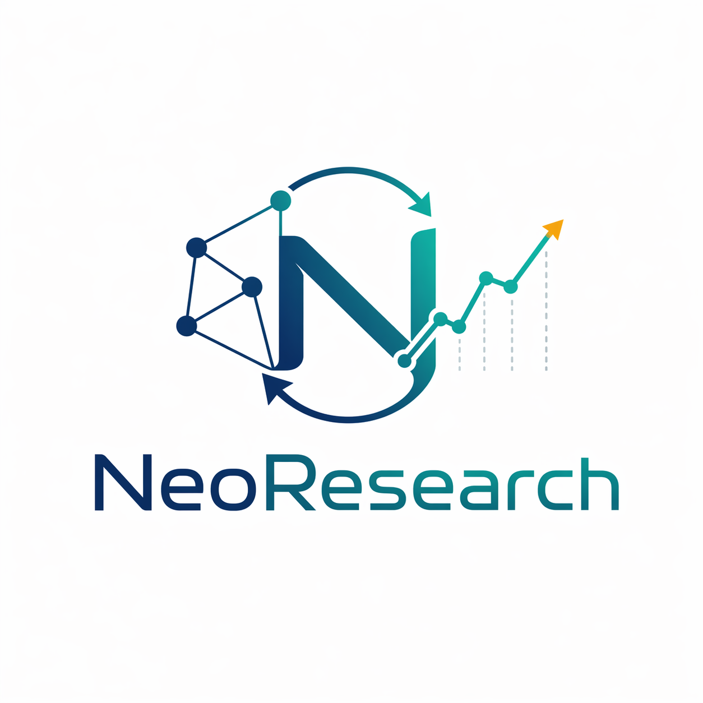
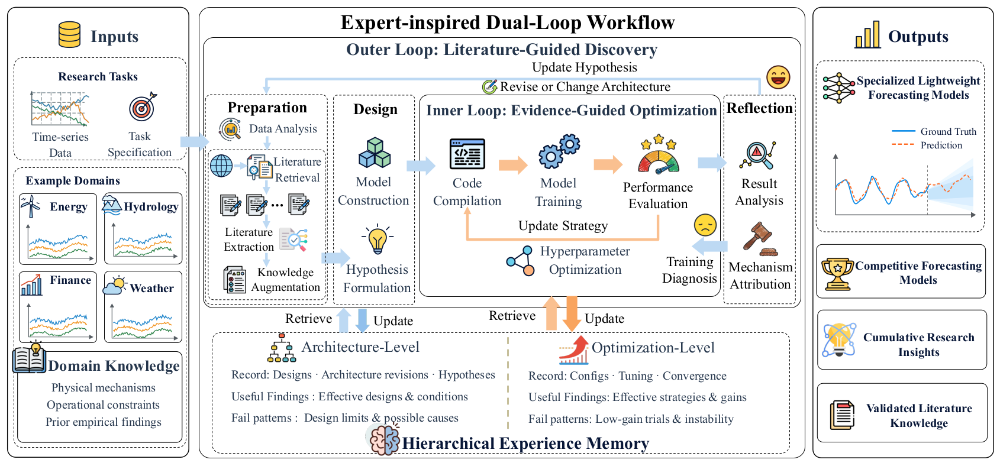
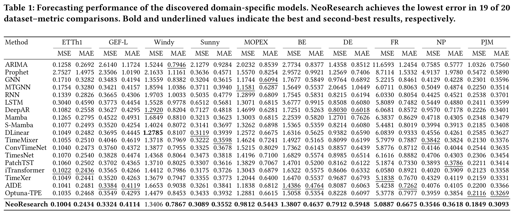

# NeoResearch



NeoResearch uses an expert-inspired dual-loop workflow to autonomously discover lightweight, domain-specific models for time series forecasting. It combines a literature-augmented outer loop for architecture discovery with an evidence-driven inner loop for training optimization. Hierarchical experience memory links literature findings to experimental outcomes and preserves lessons for reuse across forecasting tasks. Architecture-level experience guides model design in the outer loop, while optimization-level experience guides training and hyperparameter tuning in the inner loop.

**Paper** · NeoResearch: Literature- and Experience-Guided Autonomous Time Series Model Discovery · **arXiv link pending**

## Overview



*Figure 2 from the NeoResearch paper.*

- **Literature-guided architecture discovery.** In the outer loop, LLM agents extract modeling mechanisms, empirical evidence, and applicability conditions from scientific papers they find on the web. They combine these findings with task evidence and lessons from past experiments to propose testable architecture hypotheses.
- **Evidence-driven training optimization.** The inner loop holds the architecture fixed and uses validation results and convergence diagnostics to refine training settings and tune hyperparameters. These results guide further tuning or a return to the outer loop to revise the architecture.
- **Hierarchical experience memory.** The outer loop uses architecture-level records of hypotheses and design revisions to decide which designs to test or adapt. The inner loop uses optimization-level records of past training configurations, tuning outcomes, and convergence patterns to choose training settings and hyperparameters. Both levels retain the conditions under which findings apply.

## Getting Started

**NeoResearch CLI installation via npm** (Coming Soon)

### 1. Set up from source

Requires Linux or macOS, Node.js 20+, Bun 1.3.13, Python 3.10+, and [uv](https://docs.astral.sh/uv/).

Run from the repository root:

```bash
make setup
(cd neo_cast && npm install && node bin/neo-cast.js init-runtime)
make doctor
make dev-cli
```

### 2. Start a forecasting task

In the TUI, configure an LLM provider, create a task from your CSV dataset, and start the research pipeline. Choose the interaction mode that fits your task.

- **Socratic** clarifies the requirements up front, then runs the research autonomously.
- **Companion** pauses for your approval at key stages.

## Benchmark Results

In the paper's reference-initialized Alpha setting, NeoResearch achieved the lowest held-out error in 19 of 20 MSE and MAE comparisons across ten forecasting datasets.

[](assets/neoresearch-benchmark-results.png)

Section 4.3 of the paper examines the contributions of the two research loops, literature extraction, and hierarchical experience memory.

## Repository Layout

- `neoresearch/`: CLI, TUI Cockpit, web dashboard, and research orchestration.
- `neo_cast/`: dataset preparation, model recipes, training, evaluation, and export.
- `scripts/`: local setup, development, and verification tools.

## Development

```bash
make test       # Run project verification
make dev-web    # Start the web development environment
```

See the [research workflow](neoresearch/packages/neoresearch/docs/neoresearch-workflow.md), [CLI guide](neoresearch/packages/neoresearch/README.md), and [Neo-Cast usage guide](neo_cast/USAGE.md) for details.
