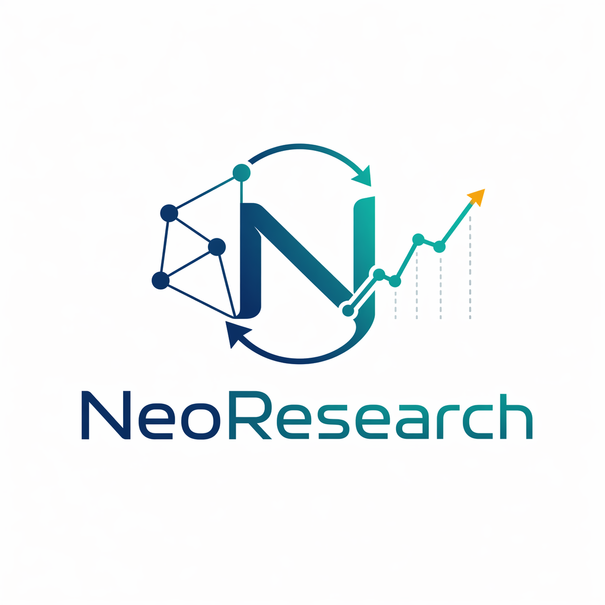
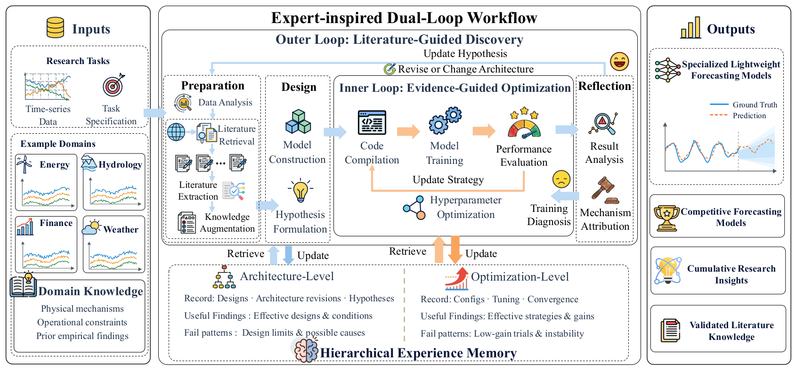
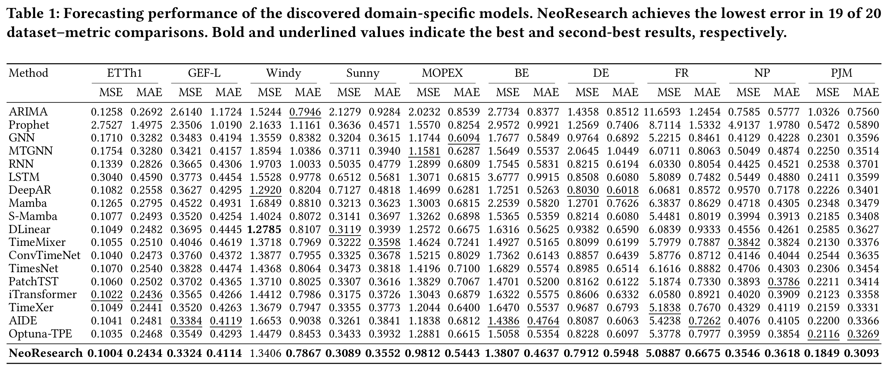

#  NeoResearch

**简体中文** | [English](README.md)

NeoResearch 以通用大语言模型（LLM）作为自主研究员，发现面向特定领域的轻量级时间序列预测模型。其受专家研究过程启发的双循环工作流，通过实验反馈，将文献引导的架构发现与证据驱动的训练优化相结合。分层经验记忆在架构和优化两个层面归纳带有适用条件的经验，为各自的研究循环提供指导，并支持同一预测任务内及跨任务的经验复用。

**论文** · NeoResearch: Literature- and Experience-Guided Autonomous Time Series Model Discovery · [arXiv:2611.18235](https://arxiv.org/abs/2611.18235)

## 概览



### 核心特性

- **文献引导的架构发现。** 将科学文献中的建模机制转化为面向目标预测任务的可检验架构假设。
- **证据驱动的训练优化。** 在模型设计固定的情况下，根据实验反馈判断应继续优化训练，还是重新审视架构假设。
- **分层经验记忆。** 分别积累架构层和优化层的经验，指导外层架构发现循环和内层训练优化循环，并支持同一预测任务内及跨任务的经验复用。

## 快速开始

**通过 npm 安装 NeoResearch CLI**（即将推出）

### 1. 从源码安装

环境要求：Linux 或 macOS、Node.js 20+、Bun 1.3.13、Python 3.10+，以及 [uv](https://docs.astral.sh/uv/)。

在仓库根目录运行：

```bash
make setup
(cd neo_cast && npm install && node bin/neo-cast.js init-runtime)
make doctor
make dev-cli
```

### 2. 启动预测任务

在终端交互界面（TUI）中配置 LLM 服务提供商，使用 CSV 数据集创建任务，然后启动研究流程。根据任务需要选择交互模式。

- **Socratic（苏格拉底式）**：先澄清任务需求，再自主开展研究。
- **Companion（协作式）**：在关键阶段暂停，等待用户批准后继续。

## 基准测试结果

在论文采用人工设计的参考模型初始化的 Alpha 设置下，NeoResearch 在十个预测数据集的 20 项 MSE 和 MAE 比较中，有 19 项取得了最低的留出测试集误差。

[](assets/neoresearch-benchmark-results.png)

论文第 4.3 节通过消融实验，分析了双循环、文献提取和分层经验记忆各自的贡献。

## 仓库结构

- `neoresearch/`：CLI、TUI Cockpit、Web 仪表盘和研究流程编排。
- `neo_cast/`：数据集准备、模型配方、训练、评估和模型导出。
- `scripts/`：本地环境配置、开发和验证工具。

## 开发

```bash
make test       # 运行项目验证
make dev-web    # 启动 Web 开发环境
```

更多信息请参阅[研究工作流](neoresearch/packages/neoresearch/docs/neoresearch-workflow.md)、[CLI 使用指南](neoresearch/packages/neoresearch/README.md)和 [Neo-Cast 使用指南](neo_cast/USAGE.md)。
