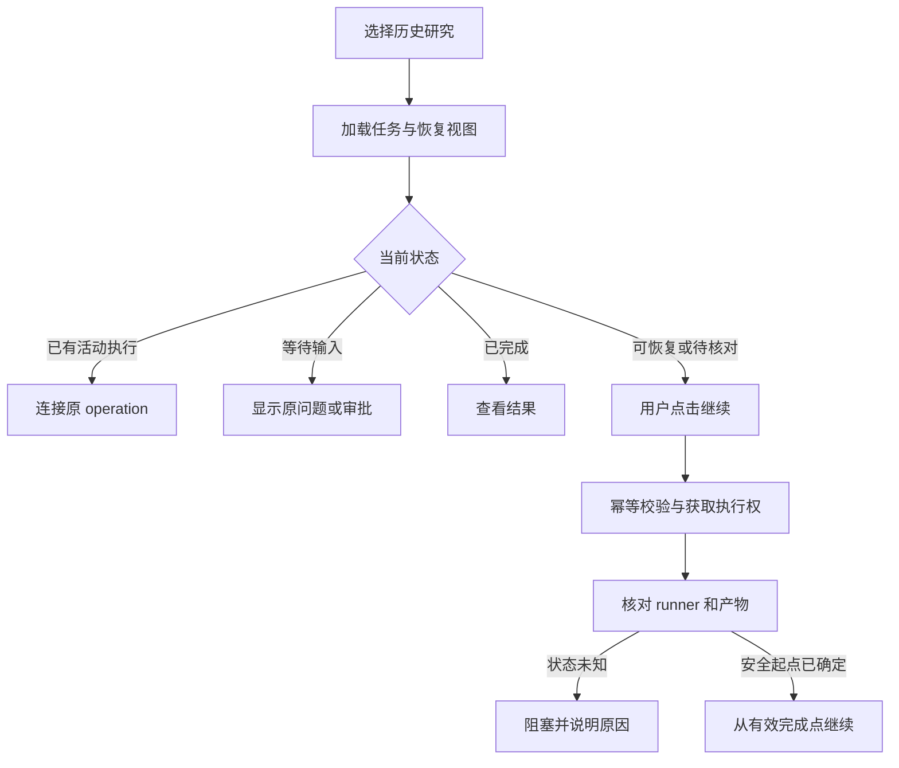

# NeoResearch TUI 历史会话恢复实施方案

日期：2026-09-22  
状态：待实施设计。本文中的新增字段、接口和测试均为实施要求，不代表已经实现。  
范围：`opencode/packages/opencode` 的 Research 服务、存储、TUI 与 runner 调用衔接。

## 1. 目标与恢复边界

用户重新进入 TUI 后，可以选择之前的研究会话，看到已有对话、任务进度、待审批事项和实验结果，并继续尚未完成的研究。系统必须避免重复训练、重复发布，以及仅因界面重开而重新计算预算。

对用户统一使用“研究会话”这个名称；内部以 `research_task.id` 作为恢复主键。OpenCode session 保存对话，run 保存单次实验，operation 保存一次后台执行。它们的 ID 不可互换，也不使用 Neo-Cast `runner_state.json` 中的 session ID 来选择 TUI 研究会话。

首版保证：

- 界面重开：恢复任务、对话和持久化进度。
- 服务仍存活：重新连接已有 operation，不启动第二次执行。
- 服务已重启：核对已有实验和产物，从最近一个有效完成点继续。
- 人工检查点：恢复原问题与审批决定，遵守已有 companion/socratic 规则。
- 实验中断：确认原执行已经结束后，必要时创建新的 attempt 重试当前实验。

首版不承诺训练 epoch、优化器状态或未完成 LLM token 流的原地恢复。训练级 checkpoint 恢复应作为独立能力，只有 runner 明确支持并验证兼容性后才能启用。

## 2. 当前实现与可复用部分

以下结论基于当前工作区源码，包含尚未提交的现有改动。

| 当前能力 | 源码位置 | 实施含义 |
| --- | --- | --- |
| task 已有 `session_id`；新任务默认创建 Research 根 session | [research.sql.ts](../opencode/packages/opencode/src/research/research.sql.ts)、[service.ts](../opencode/packages/opencode/src/research/service.ts) 的 `createTask` | 复用已有 task 与根 session 关联 |
| task、candidate、run、artifact、approval 已持久化 | 同上 | 无须重新建立一套研究结果存储 |
| pipeline 按 `metadata.workflow.completedPhases` 恢复部分阶段 | `service.ts` 的 `runFullPipeline` | 保留现有恢复函数，补齐阶段有效性与执行核对 |
| Cockpit 获取最近 30 个 task，支持 `/task select` | [research-cockpit.tsx](../opencode/packages/opencode/src/cli/cmd/tui/routes/research-cockpit.tsx) | 增加可搜索分页入口与按 ID 直接打开 |
| Cockpit 路由没有 taskID | [route.tsx](../opencode/packages/opencode/src/cli/cmd/tui/context/route.tsx) | 路由必须能稳定定位一个研究会话 |
| Cockpit chat session 映射只存在 Solid signal 中 | `research-cockpit.tsx` 的 `ensureChatSession` | 持久化专属聊天绑定，并加载历史消息 |
| 长操作支持 HTTP 202、查询、取消和进程内互斥 | [operation.ts](../opencode/packages/opencode/src/research/operation.ts)、[trace.ts](../opencode/packages/opencode/src/server/routes/instance/trace.ts) | 保留客户端协议，持久化执行收据与占有权 |
| operation 保存在 Map 中 | `operation.ts` 的 `createResearchOperations` | 服务重启后不能仅凭 operation 查询结果判定执行结束 |
| 服务初始化时将超过阈值的 queued/running run 标为 failed | `service.ts` 的 `reconcileStaleRuns` | 改为基于执行身份、心跳和结果的核对；超时不是执行已终止的证据 |

与已有 [TUI 与 Agent 修复说明](TUI与Agent修复说明_20260922.md) 衔接：保留服务存活时的断线重连、取消传递和检查点拒绝语义，在其上增加跨进程恢复。

## 3. 用户交互

### 3.1 历史入口

首页新增“历史研究”；Cockpit 增加同名命令。列表展示标题、交互模式、当前阶段、恢复状态、最后更新时间和实验完成数，支持搜索、分页、键盘选择。

选中会话后导航到 `{ type: "cockpit", taskID }`。任务详情按 ID 单独加载，不能依赖该任务是否仍在最近一页列表内。不存在或不属于当前项目时显示明确错误，不静默跳到另一个 task。

记录最近打开的 taskID 作为界面偏好；它只决定默认展示，不决定后台执行。切换任务时清理旧实时订阅，异步响应和事件均按 taskID 过滤，避免旧结果覆盖新任务。

已有 OpenCode `Switch session`：普通 session 继续打开对话页；关联研究的根 session 提供“打开研究”动作。若一个根 session 关联多个 task，应展示选择列表，不能任取第一条。子 session 可通过显式绑定或祖先链找到所属 task，不能假定只有一层 parent。

### 3.2 打开与继续分离

打开历史研究只读取状态和历史，不创建新实验、不发起 LLM 调用、不自动批准检查点。

| 服务端恢复判断 | 主按钮 | 点击行为 |
| --- | --- | --- |
| 原操作仍在运行 | 查看运行 | 订阅/轮询原 operation |
| 等待用户回答或审批 | 回答问题 / 查看审批 | 展示原问题，提交用户决定后重新判断 |
| 已暂停且可继续 | 继续研究 | 从有效完成点执行下一步 |
| 上次执行中断、结果已核对 | 继续研究 | 显示将重试的实验或待补齐步骤，按计划执行 |
| 原执行状态无法确认 | 检查状态 | 重新核对；不启动重复训练 |
| 已完成 | 查看结果 | 打开报告与产物 |
| 文件缺失或环境不匹配 | 查看原因 | 展示具体缺失项和修复入口 |

“已完成”任务的“追加研究”是独立动作，创建新搜索周期并设置预算；不能把重复点击“继续”解释成追加训练。取消保留取消记录，用户再次继续属于明确的新执行请求。

### 3.3 恢复对话与进度

- 为每个 task 保存独立 `cockpit_chat_session_id`，继续使用现有 `session_id` 作为 Agent 根 session。专属 chat 可建为该根 session 的子会话。
- 进入 Cockpit 时加载已有 chat 消息和持久化阶段摘要，再订阅新事件。没有 chat 绑定时仅在首次发送消息时创建。
- Agent 子会话仍按各自职责保存；IntentAgent 的待回答问题继续进入原 Intent session，不能改发到 Cockpit chat。
- 重进界面无需重放所有 token delta。展示完整持久化消息、阶段结果、审批和实验摘要；原始长日志提供按需查看。
- 已有无法可靠归属的 `NeoResearch Cockpit` 同名 session 不按标题自动合并。

## 4. 数据设计

以下为逻辑字段要求。实现时补齐严格 schema、数据库迁移、索引、mapper 和序列化测试。

### 4.1 task 与会话绑定

扩展 `research_task`：

| 字段 | 用途 |
| --- | --- |
| `cockpit_chat_session_id`，可空外键 | 持久化 Cockpit 聊天会话，非空时唯一归属一个 task |
| `state_revision`，整数 | 恢复计划的并发校验版本，相关执行/审批/任务变更时递增 |
| `active_cycle_id`，可空 | 当前研究周期 |

会话被删除时允许外键置空，研究结果继续保留；界面说明历史对话不可用，新消息触发创建替代会话。并发首次发送必须通过事务/唯一约束只绑定一个 chat session，防止两个 TUI 各自创建并使用不同上下文。

### 4.2 持久化 operation

新增 `research_operation`，把内存 Map 降为本进程 controller/Promise 的运行缓存。

必要字段：`id`、`project_id`、`task_id`、`cycle_id`、`action`、`request_key`、`request_digest`、`status`、`phase`、`owner_id`、`lease_expires_at`、`heartbeat_at`、`fence_token`、`result_ref`、`error`、创建/开始/完成时间。

状态：`queued / running / recovering / waiting_input / canceling / completed / failed / canceled / interrupted`。其中 `waiting_input` 不占有执行锁，审批后创建新的继续 operation。

约束与规则：

- 同一 task 只有一个活动 operation（queued/running/recovering/canceling）。通过数据库约束或事务 CAS 保证，不能只检查内存。
- `(task_id, request_key)` 唯一。同一 key、同一请求返回原收据；同一 key、不同请求内容返回 409。
- request key 由客户端在一次用户动作开始时生成，网络重试使用同一 key。不能把相同请求内容的 hash 永久当作幂等键，否则用户以后无法主动再次执行同一动作。
- 重复请求即使发生在 operation 完成之后，也返回已保存的终态收据，不重新执行。
- 租约过期只允许进入核对，不直接授权重复启动外部 runner。新 owner 接管时增加 fence token，过期 owner 的数据库写入必须被拒绝。
- 长训练期间持续更新心跳，不能只在训练结束时刷新状态。
- 单个 task 锁以外，还需核对 runner 的资源隔离。若多个 task 共用会被改写的 dataset/current_candidate/输出目录，则按规范化 runner workspace 加锁，或使用每个 task/run 独立工作目录；优先复用已有隔离机制。

### 4.3 阶段完成记录

新增 `research_phase_execution`，逐步替代 `taskSpec.metadata.workflow` 作为运行状态权威来源。旧 workflow 字段在迁移期作为兼容投影，避免两套状态分别写入。

字段包括：`id`、`task_id`、`cycle_id`、`phase`、`step_key`、`attempt`、`operation_id`、`status`、`input_digest`、`implementation_version`、`output_artifact_ids`、开始/完成时间与错误。

- phase 是 intent/data/literature/hypo/search/reflection/publish 等步骤；`step_key` 区分搜索内不同候选、轮次和重复 reflection，不能只按 phase 名去重。
- 完成依据是有效结果和产物，不是屏幕曾出现“完成”。输入摘要覆盖影响该阶段的 taskSpec、数据指纹、候选/协议和上游证据。
- 文件先写入独立临时路径，校验并原子落盘；随后在数据库事务中登记 artifact、阶段完成与 state revision。数据库不能与文件系统共用事务，因此崩溃后必须允许扫描已落盘 manifest 补登记。
- 输入或实现版本变化时，明确失效受影响阶段及其下游；保留旧记录，不把旧结果覆盖成新结果。
- 搜索中断时恢复到具体实验或结果登记步骤，不能因为整个 searching 尚未完成而重新生成全部候选。

### 4.4 搜索周期与预算

新增 `research_cycle`：记录 task、周期序号、策略快照、数据/协议指纹、状态、已完成迭代数、失败次数、no-improve 计数、已消耗资源及预算。

- 恢复同一周期沿用已消耗预算与迭代计数，不能重置 `maxIterations`、无改进计数或崩溃计数。
- 默认时间预算按累计实际执行时间计算，等待人工输入不计时；计费 token、训练尝试等已消耗资源不因失败而退回。若配置绝对截止时间，则另外保存 deadline。
- 新周期从新策略预算开始，旧周期结果保留。只有数据与评估协议可比时才允许沿用历史 champion 比较。
- 已完成或预算耗尽的周期不能通过普通 resume 自动扩容；继续使用现有预算审批规则或显式“追加研究”动作。

## 5. 接口契约

保留已有 task 和 operation 接口。为避免改变现有 `GET /research/tasks` 数组返回值，新增分页视图：

```text
GET  /research/history?search=...&cursor=...&limit=30
GET  /research/tasks/:taskID/resume-state
POST /research/tasks/:taskID/resume
POST /research/tasks/:taskID/cycles
GET  /research/tasks/:taskID/events?after=...
```

`history` 返回 `{ items, nextCursor }`，严格按当前项目过滤。游标含稳定排序键与 ID，客户端按 ID 去重；列表变化不影响按 taskID 直接打开。

`resume-state` 为只读查询，不运行模型、不创建 session、不改写 run。返回建议结构：

```json
{
  "taskID": "task_example",
  "revision": 12,
  "cycleID": "cycle_example",
  "rootSessionID": "session_root",
  "chatSessionID": "session_chat",
  "recoveryState": "resumable",
  "currentPhase": "searching",
  "activeOperation": null,
  "pendingApproval": null,
  "nextAction": "continue",
  "summary": "已完成 3 次实验，将继续当前搜索周期",
  "blockers": [],
  "eventCursor": 137
}
```

`recoveryState` 枚举为 `running / waiting_input / resumable / needs_reconciliation / blocked / completed`；它是读取真实记录后生成的视图，不与 task.status 混用。

`POST resume` 请求携带 `expectedRevision`、`requestKey`。服务端自行计算下一步，不接受客户端任意指定跳过审批的 phase。处理顺序：

1. 校验项目归属、请求 schema 和幂等键；已有相同请求时优先返回原收据。
2. 在事务内检查 revision、活动 operation 和预算，获取执行权。
3. 已有执行时返回 attach 收据；状态发生冲突时返回 409 和最新恢复视图。
4. 需要核对时启动 recovering operation；核对不清则以 blocked/等待处理结果结束，不启动训练。
5. 确定安全起点后调用统一恢复服务；返回 HTTP 202 与 operation 收据。

服务端重算审批、有效产物和预算，不因客户端持有旧快照而放行。缺失任务返回 404，参数错误返回 400；可恢复的业务阻塞提供结构化原因，不能只返回通用 500。

已有 `/pipeline`、`/autonomous/loop`、候选执行等入口都必须使用同一持久化互斥与幂等机制，避免通过旧接口绕开恢复保护。同步调用仍可等待原始结果。

新增路由同步更新 [Hono 路由](../opencode/packages/opencode/src/server/routes/instance/research.ts)、[ResearchPaths](../opencode/packages/opencode/src/server/routes/instance/httpapi/research.ts)、相关 HTTP API 注册与严格 schema。实施时搜索路径常量引用，补齐实际使用的适配层和客户端类型。

## 6. 执行恢复算法



### 6.1 服务仍存活

重新打开只重新连接原 operation。持续执行是否存活以服务/worker 的执行身份为准，不以 TUI 是否显示 busy 为准。网络超时显示连接异常，不把实验标为失败。

离开页面、切换 task、关闭客户端属于 detach；用户按取消才发 cancel。若 TUI 与服务同进程，退出导致服务结束，则进入下面的服务重启流程，不能承诺退出界面后后台仍运行。

### 6.2 服务重启或执行 owner 丢失

启动时核对持久化活动 operation，并在用户请求 resume 时再次核对。替换当前仅根据 5 分钟更新时间标 failed 的处理。

每次启动 runner 前保存 `operationID/runID/attemptID`、host、worker/进程身份、启动时间、工作目录、执行契约摘要和结果 manifest 路径。不能仅凭 PID 判断，PID 可能被复用。

| 核对结果 | 处理 |
| --- | --- |
| 可信 worker 仍执行该 attempt | 继续查询该 worker，禁止新训练 |
| 完整结果已落盘，数据库尚未登记 | 校验 task/run/attempt、契约与文件完整性后幂等补登记 |
| 执行已确认退出，未产生完整结果 | 记录 interrupted，允许创建新的 attempt |
| 执行或资源占用无法确认 | 保持 blocked，提供检查/停止原执行入口 |
| 训练完成，仅报告步骤未完成 | 从报告步骤继续，不重跑训练 |

本地孤立子进程若不能重新接管，首版采用“确认结束，或经明确停止后重试”。租约与 fence token 只能保护数据库写入，不能自动阻止旧进程继续占用 GPU 或改写文件，因此必须先解决原进程与工作目录的归属。

### 6.3 外部副作用与重试

- 新 attempt 保留原失败/中断记录，并记录 `retry_of`，不能把旧 run 重置成 queued 后覆盖历史。
- runner 的结果提交按 attempt ID 去重；阶段完成和 operation 收据必须可重复读取。
- 导出包按稳定发布标识写入独立目录；已完成包校验通过后复用。
- ref-test、blind-test 等有审批或调用次数限制的动作先检查执行凭据与已有结果。无法确认远端是否完成时进入核对，不能自动重复调用。
- 不宣称跨数据库、文件和外部进程的 exactly-once；通过持久化意图、幂等登记、互斥和结果核对实现可控重试。

## 7. 历史回放与事件一致性

新增轻量 `research_event` 持久化结构化进度事件，至少含 taskID、递增序号、operationID、run/phase 引用、事件类型、时间和摘要。

消息正文继续使用 OpenCode message/part 存储，产物继续使用 artifact；事件表不复制全部 token delta 或长训练日志。日志预览、完整日志路径及检查点摘要足以支撑 Cockpit 回放。

相关状态提交与事件登记在同一数据库事务中完成，提交后再发布实时事件。客户端读取一致快照及其 cursor，再补拉 cursor 之后的事件；实时传输中断后也按 cursor 补拉，按序号去重，避免“加载快照与开始监听之间”的进度丢失。

旧任务没有事件日志时，使用已有 artifact、run、approval 和消息生成静态摘要，不虚构旧事件时间线。

## 8. 迁移与兼容策略

1. 增量新增可空字段和表；不删除已有 session、run 或 artifact，不清空 Neo-Cast 输出目录。
2. 旧 task 的根 session 继续使用；专属 chat 懒创建，未知聊天历史不自动绑定。
3. 为旧 task 建立迁移来源的 cycle；预算使用可确定的历史 run/资源记录。无法确定剩余预算时显示需补充预算信息，不默认恢复满额预算。
4. 从 `completedPhases` 导入阶段记录前核对对应产物及输入。无法验证的阶段标为需要核对，不直接视为 completed。
5. 旧的 queued/running run 没有执行身份时不得凭超时自动重跑；进入兼容核对流程。
6. 切换运行状态权威来源后，旧 workflow 字段只由兼容投影统一更新。迁移完成前保持单一写入入口。
7. 增量 schema 允许保留旧数据，但旧程序不理解新执行锁，不能与新服务同时操作同一 workspace。回退前停止新执行并核对终态，不能只切回旧二进制继续跑。

## 9. 实施拆分与交付门槛

所有阶段属于完整目标。仅完成历史列表或 chat 绑定，不能宣称已经支持服务重启恢复。

| 阶段 | 工作内容 | 主要文件/模块 | 完成门槛 |
| --- | --- | --- | --- |
| A：存储与恢复契约 | operation/cycle/phase/event 存储、task 字段、迁移、恢复视图 schema | `research/research.sql.ts`、`schema.ts`、`task-mapper.ts`、`migration/`；新增 recovery-store 模块 | 旧数据可加载，约束与事务测试通过 |
| B：统一执行权 | operation 持久化、租约、幂等键、取消清理、runner 资源互斥 | `research/operation.ts`、`server/routes/instance/trace.ts`、runner/runtime 衔接 | 双客户端和重复请求不产生重复执行 |
| C：恢复服务 | resume-state、reconcile、阶段恢复、周期预算、结果补登记 | 新增 `research/recovery.ts`；调整 `service.ts` 和 run 调用链 | 杀掉服务后能核对并继续；不跨过审批、不重复已完成副作用 |
| D：API 与 TUI | 分页历史、taskID 路由、会话绑定、打开/继续、事件回放 | `routes/research.ts`、`httpapi/research.ts`、`context/route.tsx`、`routes/home.tsx`、`research-cockpit.tsx`；新增历史选择组件 | 真实 TUI 可选旧任务，恢复对话与进度，并正确 attach/resume |
| E：回归与文档 | 故障注入、旧数据升级、用户说明 | `test/research/`、`test/server/`、`test/cli/tui/`、TUI 使用文档 | 下述验收矩阵通过，记录真实测试结果 |

恢复判断、迁移和 runner 核对放在独立模块，避免继续向 `research-cockpit.tsx` 堆积业务逻辑。TUI 负责展示和用户动作，服务端负责恢复决策。

## 10. 验收矩阵

| 场景 | 必须满足 |
| --- | --- |
| 选择超过最近 30 条范围的历史研究 | 能搜索/翻页打开正确 task，执行请求始终带该 taskID |
| 只打开历史研究 | 零新训练、零 LLM 调用、零自动审批 |
| 切换任务时旧请求返回 | 新任务内容不被覆盖，旧事件不串入新流 |
| TUI 重开，服务存活 | 同一 operation/run 持续运行，未创建新 attempt |
| chat 已存在时重开 | 使用同一 chat session，历史消息可见 |
| 两客户端并发首次聊天/继续 | 唯一 chat 绑定、唯一活动执行，重复内容不重复提交 |
| 开始请求成功但响应丢失 | 使用同一 request key 找回原 operation |
| operation 完成后重发相同请求 | 返回原终态，不再次训练或导出 |
| 意图问题或人工审批未完成 | 恢复原问题/审批；拒绝不会被重置成 pending 或自动批准 |
| 服务在训练启动前/启动后被杀 | queued/running 意图可核对，确认执行身份后才决定重试 |
| 训练产物完成、DB 提交前被杀 | 补登记已有结果，训练调用次数不增加 |
| 发布完成、响应返回前断开 | 复用已有发布结果，不重复 ref-test/blind-test |
| owner 心跳过期但子进程仍存活 | 不另启同一实验，不与旧进程争用输出目录 |
| 用户取消后立即继续 | 等待进程树清理与锁释放，再创建新执行 |
| 恢复时预算已耗尽 | 不重置预算；进入已有预算决策流程 |
| 输入数据、协议或关键 taskSpec 改变 | 识别不兼容产物，下游阶段失效且旧记录保留 |
| 恢复视图与点击之间状态改变 | revision 冲突后刷新，不按旧计划继续 |
| 事件断线、重复投递 | cursor 补拉且无重复显示，阶段摘要与持久状态一致 |
| 根/聊天 session 被删除或任务产物缺失 | 提示真实缺失，保留研究结果，不绑定其他任务的同名 session |
| 已完成研究再次打开 | 查看结果；普通 resume 不自动开启新周期 |

测试应包括真实进程终止与数据库重开，不能仅模拟 TUI 刷新。使用临时 workspace、离线模型替身和可控 runner，分别在“外部工作开始前、工作完成后、状态提交前后”注入故障。

计划新增 `recovery.test.ts`、`recovery-restart.test.ts`、`research-resume.test.ts`、`research-history.test.tsx` 等定向测试；沿用已有 operation、service、server、TUI render 测试验证兼容性。修改测试前读取 `opencode/packages/opencode/test/AGENTS.md`。

实施后的基础检查命令（从仓库根目录进入对应包）：

```bash
cd opencode/packages/opencode
bun test test/research/operation.test.ts test/server/research-operation.test.ts --timeout 30000
bun test test/research/service.test.ts test/server/research-routes.test.ts --timeout 30000
bun test test/cli/tui/research-cockpit-data.test.ts test/cli/tui/research-cockpit-render.test.tsx --timeout 30000
bun typecheck
```

新增测试按实际文件名加入检查；迁移检查按仓库现有脚本规则执行。如修改 Neo-Cast runner 协议，还需在 `neo_cast/` 执行 `npm test`。本文是实施设计，未执行这些代码变更测试；已有测试结果不能代替恢复功能验收。

## 11. 最终交付定义

用户可以从历史入口选择任意可访问的研究会话，恢复已有对话和研究状态，并通过明确的“继续研究”动作接着执行。服务端能区分仍在运行、等待输入、已中断和已完成；重开界面、重复请求和服务重启都不会无依据地重复实验、重置预算或越过检查点。
